# nieves_2048

A new Flutter project.

# Actividad 3:

Ronda 1:
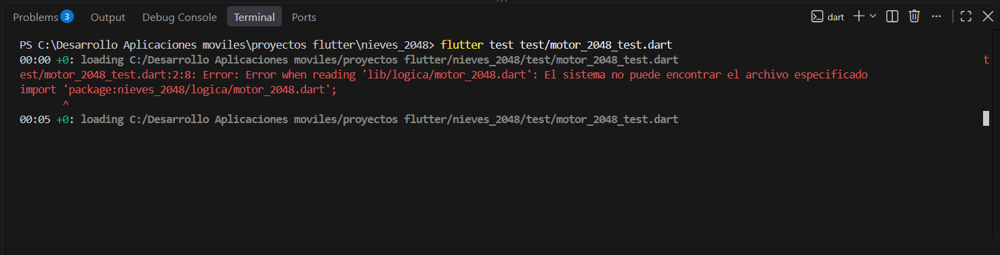
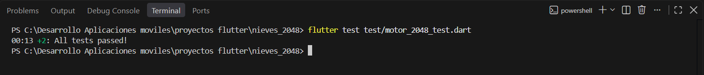

Ronda 2:
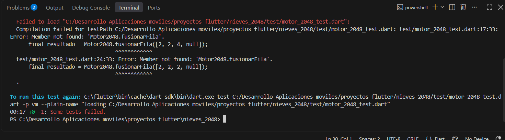
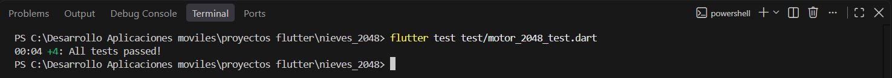

Ronda 3:
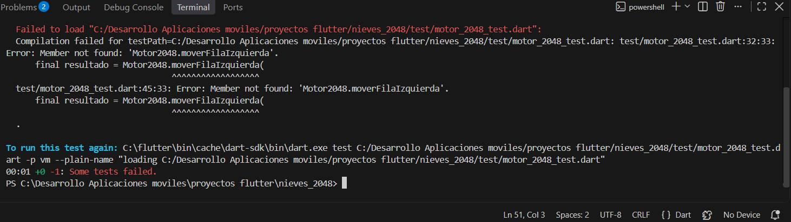
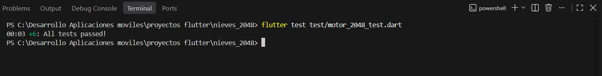

Ronda 4:
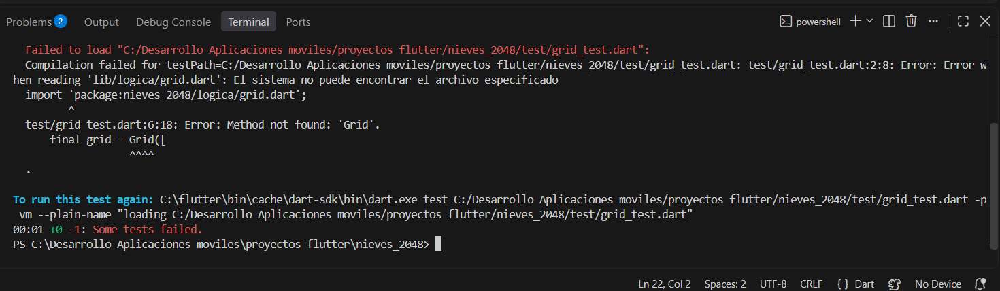
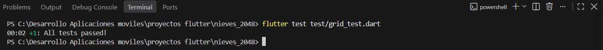

Ronda 5:
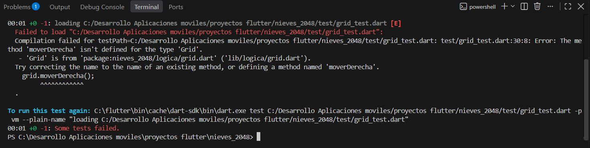
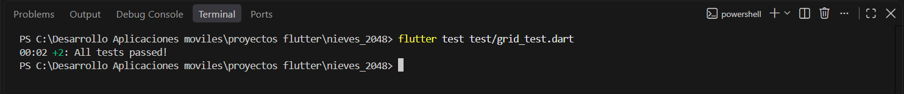

Ronda 6:
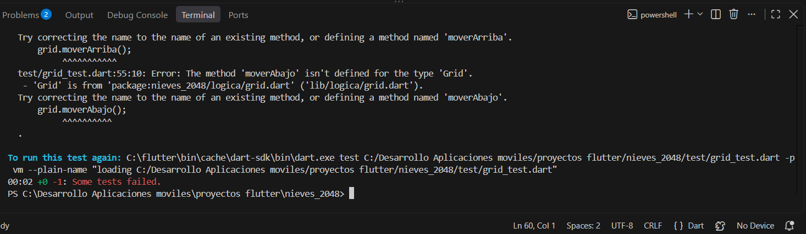
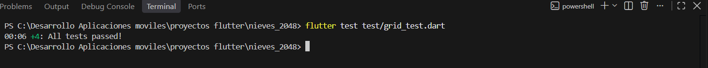

Ronda 7:
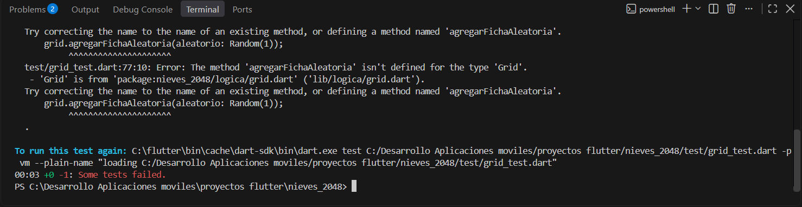
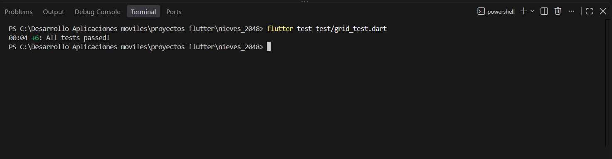

Ronda 8:
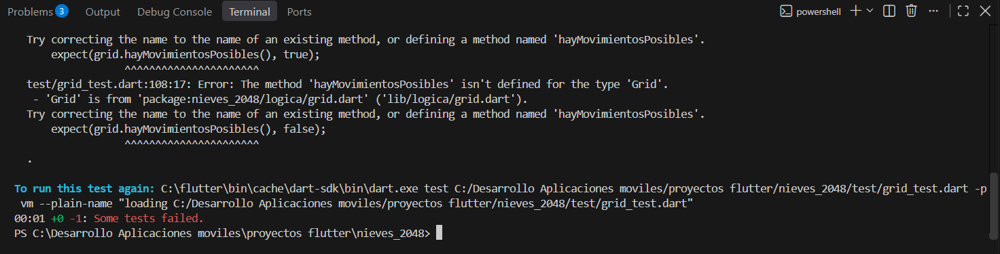
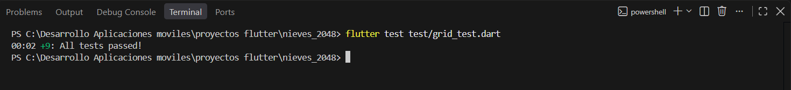

Ronda 9:
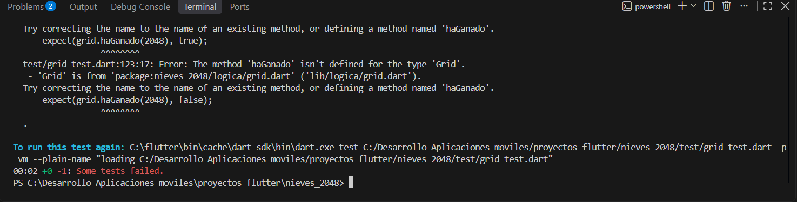
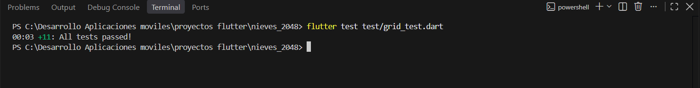

Ronda 10:
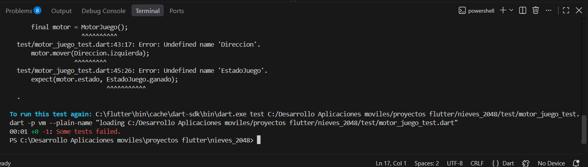
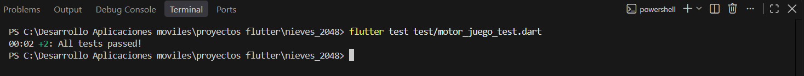

Prueba de integración:
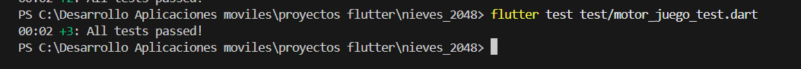

